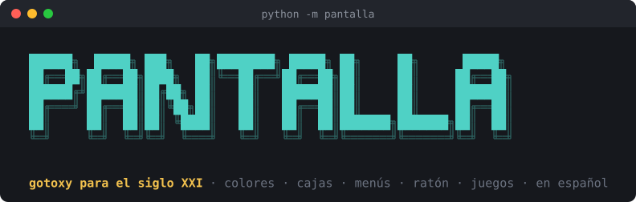
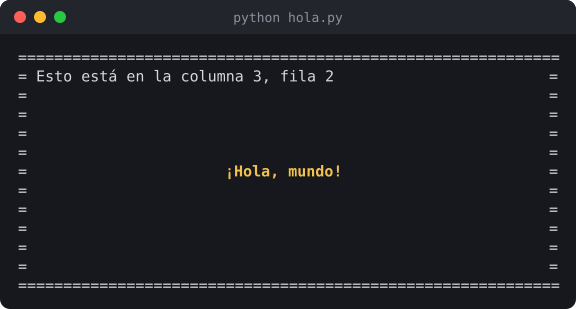
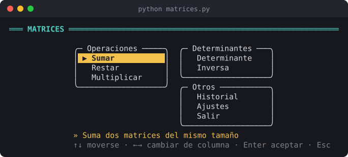
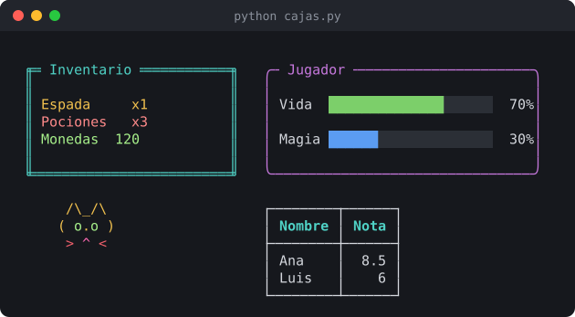
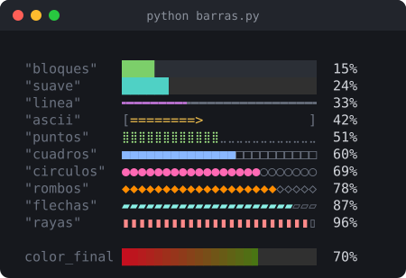
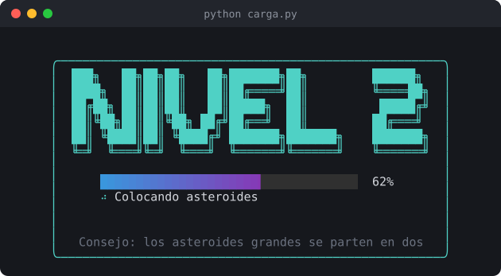
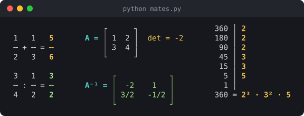
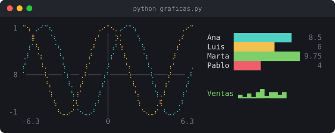
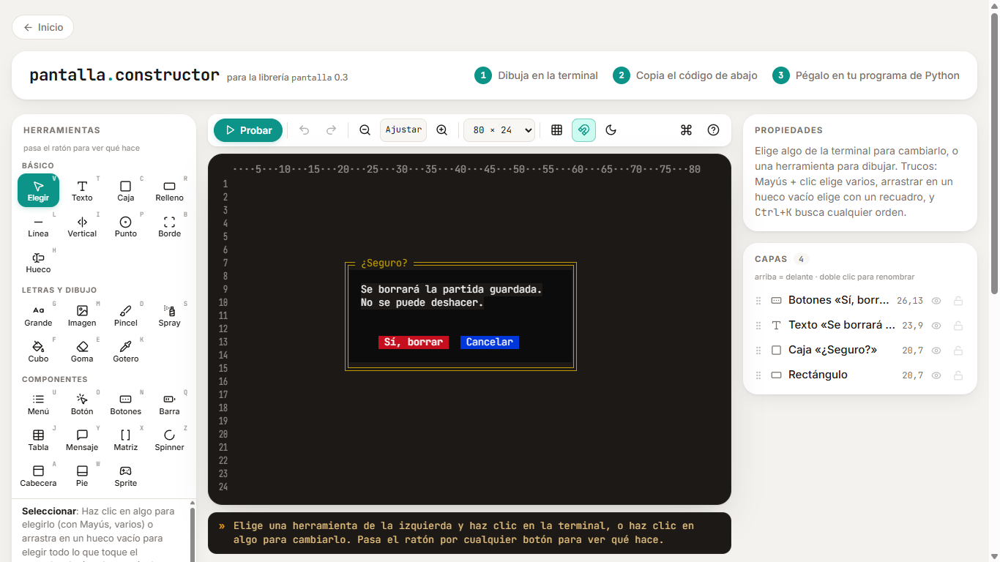
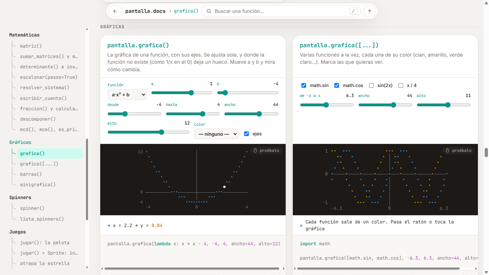

<div align="center">



<br>

[](https://pypi.org/project/pantalla/)
[](https://www.python.org/)
[](https://github.com/phernandez102/pantalla#dónde-funciona)
[](https://github.com/phernandez102/pantalla/blob/main/LICENSE)

**[Constructor web](https://phernandez102.github.io/pantalla/)** ·
**[Instalar](https://github.com/phernandez102/pantalla#instalar)** ·
**[Todo lo que hay](https://github.com/phernandez102/pantalla#todo-lo-que-hay)** ·
**[Hacer un juego](https://github.com/phernandez102/pantalla#hacer-un-juego)** ·
**[Ejemplos](https://github.com/phernandez102/pantalla#ejemplos)**

</div>

<br>

**pantalla** convierte la terminal en un lienzo para aprender Python. Con una línea pones texto donde quieras y con colores, dibujas cajas y menús, escribes títulos con 32 fuentes ASCII o conviertes una imagen en arte de caracteres. Tiene botones que responden al ratón, barras, spinners y pantallas de carga para las tareas largas, y un modo juego: escribes qué pasa en cada momento y la librería se encarga del resto, sin parpadeos y sin bucles infinitos. Y para clase de mates trae matrices, fracciones exactas, sistemas por Gauss paso a paso y gráficas de funciones. Todo en español.

<table>
<tr>
<td width="48%">

```python
import pantalla

pantalla.limpiar()
pantalla.rodear("=")
pantalla.centrar("¡Hola, mundo!",
                 color="amarillo",
                 negrita=True)
pantalla.gotoxy(3, 2)
print("Esto está en la columna 3, fila 2")
pantalla.esperar()
```

</td>
<td width="52%">

</td>
</tr>
</table>

- No necesita instalar nada más (solo Python 3.8 o más nuevo).
- Funciona en Windows, Linux y Mac.
- Se mezcla sin problemas con `print()` e `input()`.
- Si te equivocas, los errores te dicen qué ha pasado en español: `No conozco el color 'rojoo'. ¿Querías decir 'rojo'?`
- Tiene un **constructor web**: dibujas la pantalla con el ratón, copias el código y lo pegas en tu programa.

<table>
<tr>
<td valign="top" width="52%"></td>
<td valign="top" width="48%"></td>
</tr>
<tr>
<td align="center"><sub><code>pantalla.menu({...})</code> con secciones y ayuda</sub></td>
<td align="center"><sub><code>caja()</code>, <code>barra_progreso()</code>, <code>arte()</code> y <code>tabla()</code></sub></td>
</tr>
</table>

## Instalar

```
pip install pantalla
```

Para ver todo lo que hace, abre una demostración:

```
python -m pantalla
```

Y desde Python, `pantalla.ayuda()` abre un menú con todas las funciones: eliges una con las flechas y te enseña cómo se usa. `pantalla.ayuda("caja")` te lo dice directamente de una.

## Dónde funciona

En cualquier terminal de verdad: **cmd**, **PowerShell**, **Windows Terminal**, la terminal de **VS Code**, la de Linux o la de Mac.

**IDLE** no es una terminal. En Windows, si pulsas F5 en IDLE, pantalla abre tu programa en una ventana de cmd y lo ejecuta allí (si no quieres que lo haga, pon la variable de entorno `PANTALLA_NO_ABRIR=1`). En Linux y Mac, ejecútalo desde la terminal. En **Thonny**, usa *Ejecutar → Ejecutar el script actual en terminal*.

## Cómo funcionan las posiciones

La pantalla es una cuadrícula de letras. `x` es la columna (hacia la derecha) e `y` la fila (hacia abajo). **Las dos empiezan en 1**: la esquina de arriba a la izquierda es `(1, 1)`.

```
(1,1) ──────────── x ───────────▶ (80,1)
  │
  │       pantalla.gotoxy(10, 3)
  y                 ▼
  │                 aquí
  ▼
(1,24)                            (80,24)
```

`pantalla.ancho()` y `pantalla.alto()` te dicen cuánto mide la tuya. Si haces cuentas como `pantalla.ancho() / 2` y te sale un número con decimales, no pasa nada: se redondea solo.

**¿No sabes en qué posición está algo?** Escribe en la terminal `python -m pantalla depurar`: sale una cruz que mueves con las flechas y te dice su `x` y su `y` (y el `gotoxy` que tienes que escribir). Dentro de tu programa, `pantalla.regla()` pinta los números de las columnas y las filas en los bordes.

## Todo lo que hay

[Pantalla y cursor](https://github.com/phernandez102/pantalla#pantalla-y-cursor) · [Escribir](https://github.com/phernandez102/pantalla#escribir) · [Colores](https://github.com/phernandez102/pantalla#colores) · [Dibujar](https://github.com/phernandez102/pantalla#dibujar) · [Teclado](https://github.com/phernandez102/pantalla#teclado) · [Cosas ya hechas](https://github.com/phernandez102/pantalla#cosas-ya-hechas) · [Barras y pantallas de carga](https://github.com/phernandez102/pantalla#barras-y-pantallas-de-carga) · [Ratón](https://github.com/phernandez102/pantalla#ratón) · [Matrices](https://github.com/phernandez102/pantalla#matrices) · [Fracciones y números](https://github.com/phernandez102/pantalla#fracciones-y-números) · [Gráficas](https://github.com/phernandez102/pantalla#gráficas)

`pantalla.ayuda()` abre un menú con todas, y si escribes mal un nombre el error te dice cuál querías.

### Pantalla y cursor

| Función | Qué hace |
|---|---|
| `limpiar()` | Borra la pantalla |
| `limpiar_linea(y)` | Borra una línea |
| `gotoxy(x, y)` | Mueve el cursor (también se llama `ir_a`) |
| `ancho()`, `alto()`, `tamano()` | Lo que mide la terminal |
| `centro()` | Devuelve `(x, y)` del centro |
| `ocultar_cursor()`, `mostrar_cursor()` | Esconde o enseña el cursor |
| `guardar_posicion()`, `volver_a_posicion()` | Apunta dónde está el cursor y vuelve luego |
| `titulo_ventana("Mi juego")` | Cambia el título de la ventana |
| `pitido()` | Bip |
| `pausa(0.5)` | Espera medio segundo |
| `iniciar()`, `terminar()` | Prepara la terminal para un juego y la deja como estaba |
| `regla()` | Pinta los números de columnas y filas, para ver posiciones |
| `depurar()` | Herramienta para ver posiciones moviendo una cruz con las flechas |

### Escribir

```python
pantalla.escribir("Hola", 10, 5)                                  # columna 10, fila 5
pantalla.escribir("Peligro", 10, 6, color="rojo", negrita=True)
pantalla.escribir("Puntos: 120", 1, 1, color="negro", fondo="amarillo")
pantalla.escribir("Centrado", "centro", 5)                         # centrado en la fila 5
pantalla.centrar("GAME OVER", color="rojo")                        # en el centro de la pantalla
pantalla.centrar("Pulsa una tecla", y=20)                          # centrado en la fila 20
pantalla.escribir_derecha("Vidas: 3", 1)                           # pegado a la derecha
pantalla.escribir_lento("Había una vez...", 5, 3, velocidad=0.08)  # letra a letra
pantalla.grande("HOLA", color="amarillo")                          # letras gigantes
print(pantalla.texto_grande("FIN"))                                # letras gigantes con print
pantalla.cabecera("MATRICES · Suma")                               # barra con título arriba
pantalla.pie("↑↓ moverse   Enter elegir   Esc salir")              # texto en la última fila
```

Si el texto tiene varias líneas (con `\n`), todas empiezan en la misma columna, así que puedes hacer dibujos:

```python
pantalla.escribir(" /\\_/\\\n( o.o )\n > ^ <", 30, 10, color="naranja")
```

Estilos que puedes poner a cualquier texto: `negrita`, `tenue`, `cursiva`, `subrayado`, `parpadeo`, `invertido` y `tachado`.

#### Fuentes ASCII art

`grande()` y `texto_grande()` tienen `fuente=`, con 32 fuentes FIGlet (las mismas de las webs de "texto a ASCII art"). Sin fuente usa `"bloques"`, la de siempre.

```python
pantalla.grande("Hola", fuente="slant", color="cian")
print(pantalla.texto_grande("Hola", fuente="standard"))
print(pantalla.lista_fuentes())     # ['bloques', '3-d', 'ansi_regular', 'ansi_shadow', ...]
```

```
    __  __      __            _   _       _
   / / / /___  / /___ _      | | | | ___ | | __ _
  / /_/ / __ \/ / __ `/      | |_| |/ _ \| |/ _` |
 / __  / /_/ / / /_/ /       |  _  | (_) | | (_| |
/_/ /_/\____/_/\__,_/        |_| |_|\___/|_|\__,_|
   fuente="slant"            fuente="standard"

 █████╗ ███╗   ██╗███████╗██╗
██╔══██╗████╗  ██║██╔════╝██║
███████║██╔██╗ ██║███████╗██║
██╔══██║██║╚██╗██║╚════██║██║
██║  ██║██║ ╚████║███████║██║
╚═╝  ╚═╝╚═╝  ╚═══╝╚══════╝╚═╝
        fuente="ansi_shadow"
```

El nombre vale en mayúsculas o con espacios (`"ANSI Shadow"`). Si una letra no está en la fuente se usa la misma sin tilde (á → a), y si tampoco está, se salta.

### Colores

Los colores se escriben en español, con o sin tildes y mayúsculas:

`negro`, `rojo`, `verde`, `amarillo`, `azul`, `morado`, `cian`, `gris claro`, `gris`, `rojo claro`, `verde claro`, `amarillo claro`, `azul claro`, `morado claro`, `cian claro`, `blanco`, `naranja`, `marrón`, `rosa`.

También valen en hexadecimal (`"#ff8800"`), en RGB (`(255, 136, 0)`) o con un número del 0 al 255.

```python
print("Esto es", pantalla.colorear("importante", "rojo", negrita=True))

pantalla.poner_color("verde")        # a partir de aquí todo sale en verde, también con print
print("Verde")
pantalla.quitar_color()              # vuelta a lo normal

pantalla.poner_color(fondo="azul")
pantalla.limpiar()                   # ¡toda la pantalla azul!
```

### Dibujar

```python
pantalla.rodear()                                    # borde alrededor de toda la pantalla
pantalla.rodear("=")                                 # con =
pantalla.rodear("*", color="amarillo", titulo="Mi juego")

pantalla.caja(5, 3, 30, 10)                          # x, y, ancho, alto
pantalla.caja(5, 3, 30, 10, estilo="doble", color="cian", titulo="Inventario")
pantalla.caja(5, 3, 30, 10, relleno=True)            # borra lo que haya dentro
pantalla.caja(ancho=40, alto=8, titulo="Aviso")      # sin x ni y: en el centro

pantalla.linea(12)                                   # línea horizontal en la fila 12
pantalla.linea(12, "-", x=5, largo=20, color="gris")
pantalla.linea_vertical(40)                          # línea vertical en la columna 40
pantalla.rellenar(10, 5, 20, 4, fondo="azul")        # un rectángulo de color
pantalla.rellenar(10, 5, 20, 4)                      # borra esa zona
pantalla.punto(10, 5, "@", color="amarillo")         # un solo carácter
```

Estilos de borde: `"simple"` ┌─┐, `"doble"` ╔═╗, `"grueso"` ┏━┓, `"redondo"` ╭─╮, `"ascii"` +-+ o cualquier carácter, como `"="` o `"#"`.

#### Arte ASCII (con colores)

`arte()` dibuja un dibujo hecho con letras. Los espacios son transparentes (no borran lo de debajo):

```python
gato = r'''
 /\_/\
( o.o )
 > ^ <
'''
pantalla.arte(gato, 10, 5, color="amarillo")
```

Para darle color a cada letra, pásale otro dibujo del mismo tamaño con una letra de color en cada sitio:

```python
pantalla.arte(["(^_^)", "/| |\\"], 5, 5,
              colores=["aaaaa",
                       "vv vv"])
```

Códigos: `r` rojo, `v` verde, `a` amarillo, `z` azul, `m` morado, `c` cian, `b` blanco, `n` negro, `g` gris, `o` naranja, `x` marrón, `p` rosa; en mayúscula la versión "claro" (`R` rojo claro, `G` gris claro...). Un espacio o un punto deja el color normal. `fondos=` funciona igual para el fondo. Con `transparente=False` los espacios sí borran. Están en `pantalla.CODIGOS_COLOR`.

El constructor web convierte imágenes en arte ASCII y te da el código de `arte()` ya hecho.

### Teclado

```python
t = pantalla.tecla()            # espera a que pulses una tecla (sin Enter)
if t == "arriba":
    ...

nombre = pantalla.pedir("¿Cómo te llamas? ")                          # como input()
nombre = pantalla.pedir("Nombre: ", 10, 5, color="cian")              # en una posición
edad = pantalla.pedir_numero("Edad: ", minimo=0, maximo=120)          # insiste hasta que sea un número
precio = pantalla.pedir_numero("Precio: ", decimales=True)            # vale 2,5 y 2.5
clave = pantalla.pedir_contrasena()                                   # no se ve lo que escribes
if pantalla.confirmar("¿Quieres salir? (s/n) "):                      # True o False
    ...
pantalla.esperar()                                                    # "Pulsa una tecla para continuar..."
```

`tecla()` devuelve las letras tal cual (`"a"`, `"A"`, `"ñ"`, `"7"`) y estos nombres para las especiales:

`"arriba"`, `"abajo"`, `"izquierda"`, `"derecha"`, `"enter"`, `"espacio"`, `"esc"`, `"tab"`, `"borrar"`, `"suprimir"`, `"insertar"`, `"inicio"`, `"fin"`, `"repag"`, `"avpag"`, `"f1"` … `"f12"`, `"ctrl+a"` … y `"alt+x"` …

### Cosas ya hechas

```python
opcion = pantalla.menu(["Jugar", "Opciones", "Salir"], titulo="Menú")   # con flechas y Enter
if opcion == "Jugar":
    ...

pantalla.mensaje("¡Has ganado!", titulo="Enhorabuena", color_borde="verde")
dificultad = pantalla.elegir("Dificultad:", ["Fácil", "Normal", "Difícil"])   # opciones en fila, con ← →

pantalla.tabla([["Ana", 8.5], ["Luis", 6]], cabeceras=["Nombre", "Nota"])

juegos = pantalla.elegir_varios(["Ajedrez", "Damas", "Parchís"], titulo="¿A qué juegas?")   # se marcan con Espacio
datos = pantalla.formulario({"Nombre": "texto", "Edad": "numero", "Contraseña": "contraseña"})
print(datos["Nombre"], datos["Edad"])
```

- `menu()` devuelve el texto de la opción elegida (o `None` si pulsas Esc). También se puede elegir pulsando el número. Si hay más opciones de las que caben, el menú hace scroll.
- `elegir_varios()` devuelve la lista de lo que has marcado y `formulario()` un diccionario con lo que has escrito en cada casilla (los dos `None` si pulsas Esc).
- En el formulario cada casilla puede ser `"texto"`, `"numero"`, `"decimal"`, `"fraccion"` o `"contraseña"`.

#### Menús con ayuda, iconos y secciones

```python
opcion = pantalla.menu(
    ["Jugar", "Opciones", "Salir"],
    ayudas={"Jugar": "Empieza una partida nueva", "Salir": "Cierra el juego"},   # sale debajo
    iconos={"Jugar": "►", "Opciones": "*", "Salir": "×"},
)

# la explicación también puede ir en otro sitio, por ejemplo abajo del todo:
AYUDA = {"Jugar": "Empieza una partida nueva", "Salir": "Cierra el juego"}
opcion = pantalla.menu(["Jugar", "Salir"], ayudas=AYUDA,
                       ayuda_x=3, ayuda_y=pantalla.alto() - 2, color_ayuda="cian")
```

Si le das un **diccionario** en vez de una lista, hace un menú con cada sección en su caja y en columnas, como el de un programa de verdad. Te mueves con las cuatro flechas:

```python
opcion = pantalla.menu({
    "Operaciones": ["Sumar", "Restar", "Multiplicar"],
    "Determinantes": ["Determinante", "Inversa"],
    "Otros": ["Historial", "Ajustes", "Salir"],
}, ayudas={"Sumar": "Suma dos matrices del mismo tamaño"})
```

### Barras y pantallas de carga

<table>
<tr>
<td valign="top" width="42%"></td>
<td valign="top" width="58%"></td>
</tr>
<tr>
<td align="center"><sub><code>barra_progreso(estilo=...)</code></sub></td>
<td align="center"><sub><code>pantalla_de_carga()</code></sub></td>
</tr>
</table>

`barra_progreso()` dibuja una barra en un sitio. Para que avance, la vuelves a llamar con otro valor:

```python
for i in range(101):
    pantalla.barra_progreso(i, 100, 10, 5)        # valor, total, columna, fila
    pantalla.pausa(0.02)

pantalla.barra_progreso(40, 100, 10, 7, estilo="suave", color="cian")
pantalla.barra_progreso(vida, 100, 2, 1, color="rojo", color_final="verde", texto="Vida")
```

Los estilos son los de la imagen: `"bloques"` (el normal), `"suave"`, `"linea"`, `"ascii"`, `"puntos"`, `"cuadros"`, `"circulos"`, `"rombos"`, `"flechas"` y `"rayas"`. Dos detalles:

- `"suave"` avanza de octavo en octavo de casilla, así que se mueve sin saltos aunque la barra sea corta.
- `"ascii"` (`[=====>    ]`) solo usa letras normales: sale bien en cualquier terminal, también en las antiguas.

Y más opciones:

- `color_final=`: la barra va cambiando de `color` a este, casilla a casilla. Vale con nombres, `"#rrggbb"` o `(r, g, b)`.
- `lleno=` y `vacio=`: tus propios caracteres, que mandan sobre los del estilo.
- `texto=`: un nombre delante de la barra. `porcentaje=False` quita el número.
- Sin x ni y, la barra sale donde esté el cursor, y cada llamada la sobrescribe en la misma línea.
- `pantalla.lista_barras()` te da todos los estilos.

#### Pantallas de carga

`pantalla_de_carga()` limpia la terminal y pone en el centro un título, la barra, lo que se está haciendo y, si quieres, consejos que van cambiando. Al acabar enseña ✔ Listo y la borra. Hay tres formas de usarla, de la más fácil a la más completa:

```python
# 1. de mentira: tarda 3 segundos y se va (queda bien antes de empezar un juego)
pantalla.pantalla_de_carga("Cargando nivel 1", segundos=3)

# 2. con tareas: un texto es un paso de mentira y una función se llama de verdad
mapa, enemigos = pantalla.pantalla_de_carga("Preparando", tareas=[
    ("Leyendo el mapa", leer_mapa),
    ("Colocando enemigos", colocar_enemigos),
    "Afinando los sonidos",
])

# 3. tú mueves la barra, con with
with pantalla.pantalla_de_carga("Descargando", total=len(archivos)) as carga:
    for archivo in archivos:
        carga.avanzar(texto=archivo)       # suma 1 y cambia el texto de debajo
        descargar(archivo)
```

Con tareas devuelve lo que devuelvan tus funciones, en el mismo orden. Con `with`, además de `avanzar()` puedes poner `carga.valor = 7` o `carga.texto = "Casi está"`.

Para dejarla a tu gusto:

```python
pantalla.pantalla_de_carga(
    "NIVEL 2", segundos=4,
    fuente="ansi_shadow",                    # el título en letras grandes
    estilo="suave", color="cian", color_final="morado claro",
    consejos=["Consejo: los asteroides grandes se parten en dos", "Pulsa P para pausar"],
    marco="redondo",                         # un borde alrededor
)
```

- `total=None`: para cuando no sabes cuánto falta. Un trozo de barra va y viene.
- `spinner=`: la ruedecita de al lado del texto. Vale cualquier estilo de `lista_spinners()`, o `None` para quitarla.
- `borrar=False`: la deja en la pantalla al acabar.
- Los consejos cambian cada 4 segundos. Si las letras grandes no caben en la terminal, pone el título normal.
- La animación va en un hilo aparte, así que sigue moviéndose aunque tu función tarde. Úsala antes de `jugar()`, no dentro: dentro de un juego, dibuja una `barra_progreso()` en cada fotograma.
- En IDLE, sin terminal de verdad, escribe los pasos uno debajo de otro.

#### Spinners (la ruedecita que gira mientras trabajas)

Como la librería [halo](https://github.com/manrajgrover/halo): gira sola mientras tu programa sigue.

```python
with pantalla.spinner("Descargando..."):       # al acabar pone ✔ (o ✖ si hay un error)
    descargar_todo()

s = pantalla.spinner("Paso 1", estilo="arco", color="amarillo").empezar()
s.texto = "Paso 2"                             # cambia el texto mientras gira
s.bien("Hecho")                                # ✔ Hecho   (también mal(), aviso(), info(), parar())

pantalla.spinner("Guardando", x=10, y=5)       # en un sitio fijo de la pantalla
pantalla.lista_spinners()                      # los ~60 estilos: "dots", "line", "arc", "pelota", "tiburon"...
```

Sin terminal de verdad (IDLE) no gira: escribe el texto una vez y luego el final.

Y dos más sencillas, que esperan un rato y siguen:

```python
pantalla.cargando(3, "Guardando partida")    # "Cargando..." en la línea donde estés, durante 3 segundos
pantalla.calculando()                        # ventanita de "Calculando..." en el centro
```

### Ratón

```python
pantalla.activar_raton(hover=True)             # hover=True: también se entera de cuándo mueves el ratón

opcion = pantalla.botones(["Jugar", "Opciones", "Salir"])   # botones que se pulsan con clic (o flechas + Enter)

x, y, boton = pantalla.esperar_clic()          # espera un clic; boton es "izquierdo", "derecho" o "central"
clic = pantalla.leer_raton()                   # como tecla_pulsada(): None si no hay clic
pos = pantalla.posicion_raton()                # (x, y) de dónde está el ratón

aceptar = pantalla.boton("Aceptar", 10, 10, al_clic=lambda: "ok")     # cambia de color al pasar por encima
cancelar = pantalla.boton("Cancelar", 22, 10, al_clic=lambda: "no")
zona = pantalla.zona(5, 3, 20, 4, al_clic=lambda: "zona")             # un rectángulo invisible que se puede pulsar
resultado = pantalla.bucle([aceptar, cancelar, zona])                 # espera hasta que algo devuelva un valor (o Esc)

pantalla.desactivar_raton()
```

Funciona en Windows (cmd, PowerShell, Windows Terminal) y en las terminales de Linux y Mac.

### Matrices

```python
A = pantalla.pedir_matriz("A")                        # eliges el tamaño con las flechas y rellenas cada hueco
B = pantalla.pedir_matriz("B", filas=2, columnas=3)   # tamaño fijo
C = pantalla.pedir_matriz("C", cuadrada=True)         # filas y columnas suben a la vez

pantalla.matriz(A)                          # la dibuja con corchetes, como un print
pantalla.matriz(A, 5, 3, nombre="A")        # en la columna 5, fila 3, con "A ="
pantalla.matriz(A, 5, 3, det=True)          # con barras, como un determinante
```

`pedir_matriz()` acepta enteros, decimales (`2.5` o `2,5`) y fracciones (`1/2`). Devuelve una lista de filas, por ejemplo `[[1, 2], [3, 4]]`. Con `fracciones=True` devuelve `Fraction` en vez de decimales.

Las cuentas se hacen con fracciones exactas, así que la inversa sale `1/3` y no `0.3333333`:

```python
A = [[2, 1], [1, -1]]

pantalla.sumar_matrices(A, B)       # también restar_matrices()
pantalla.multiplicar_matrices(A, B) # o un número por una matriz: multiplicar_matrices(2, A)
pantalla.transpuesta(A)
pantalla.potencia_matriz(A, 3)      # A·A·A
pantalla.identidad(3)
pantalla.traza(A)                   # 1
pantalla.determinante(A)            # -3
pantalla.inversa(A)                 # [[1/3, 1/3], [1/3, -2/3]]
pantalla.rango(A)                   # 2
```

Si la matriz no tiene inversa, el error te dice por qué: `inversa: esta matriz no tiene inversa porque su determinante es 0`.

#### Gauss y sistemas de ecuaciones

```python
pantalla.escalonar(A, pasos=True)                 # enseña cada paso: F2 → F2 - 2·F1
pantalla.escalonar(A, reducida=True)              # Gauss-Jordan

# 2x + y = 5
#  x - y = 1
pantalla.resolver_sistema([[2, 1], [1, -1]], [5, 1], pasos=True)   # Solución: x = 2,  y = 1
pantalla.clasificar_sistema([[1, 1], [2, 2]], [3, 6])              # "compatible indeterminado"
pantalla.matriz([[2, 1, 5], [1, -1, 1]], ampliada=True)           # con la raya antes de la última columna
```

`resolver_sistema()` devuelve la lista con las soluciones, o `None` si el sistema no tiene una sola solución (con `pasos=True` te dice si es porque no tiene ninguna o porque tiene infinitas). En vez de `b` le puedes dar directamente la matriz ampliada.

### Fracciones y números

<p align="center"></p>

```python
f = pantalla.fraccion("3/4")                       # también fraccion(3, 4) o fraccion("0,75")
print(f + pantalla.fraccion("1/6"))                # 11/12
f = pantalla.pedir_fraccion("Dime una fracción: ")  # insiste hasta que lo sea

pantalla.calcular("3/4 + 1/6")                     # 11/12, también valen ÷, : y ^
pantalla.escribir_cuenta("1/2 + 1/3", 5, 3)        # la dibuja como en el cuaderno, con el resultado
```

Y para trabajar con enteros:

```python
pantalla.mcd(12, 18)        # 6
pantalla.mcm(4, 6)          # 12
pantalla.es_primo(97)       # True
pantalla.divisores(12)      # [1, 2, 3, 4, 6, 12]
pantalla.factorizar(360)    # {2: 3, 3: 2, 5: 1}
pantalla.descomponer(360)   # la tabla de dividir entre primos y 360 = 2³ · 3² · 5
```

### Gráficas

<p align="center"></p>

```python
import math

def f(x):
    return x * x - 4

pantalla.grafica(f, -4, 4)                                 # y = x² - 4, de x = -4 a x = 4
pantalla.grafica([math.sin, math.cos], -6.3, 6.3)          # varias a la vez, cada una de un color
pantalla.grafica(f, -4, 4, 10, 3, ancho=40, alto=12)       # en la columna 10, fila 3

pantalla.barras({"Ana": 8.5, "Luis": 6, "Marta": 9.75}, maximo=10)
print("Esta semana:", pantalla.minigrafica([3, 1, 4, 1, 5, 9, 2, 6]))   # ▃▁▄▁▅█▂▅
```

Si la función falla en algún punto (como `1/x` en el 0), ese punto se deja en blanco y sigue.

## Hacer un juego

Con `pantalla.jugar()` no hace falta ningún `while`: escribes una función que dibuja **un momento** del juego y `jugar()` la llama 20 veces por segundo (o las que digas con `velocidad=`). Todo lo que dibujas sale de golpe, sin parpadeos, y al acabar la terminal queda como estaba.

```python
import pantalla

nave = pantalla.Sprite("/^\\", 30, 20, color="verde")    # un dibujo que se mueve: se pinta solo

def actualizar(tecla):                 # tecla: la que se acaba de pulsar, o None
    if pantalla.pulsada("izquierda"):  # True mientras la mantienes pulsada
        nave.mover(-1, 0)
    if pantalla.pulsada("derecha"):
        nave.mover(1, 0)
    if pantalla.cada(1):               # True una vez cada segundo
        ...
    pantalla.escribir("Fotograma %d" % pantalla.fotograma(), 1, 1)
    if tecla == "q":
        return "adiós"                 # devolver algo acaba el juego

resultado = pantalla.jugar(actualizar, velocidad=20, ancho=60, alto=22)   # Esc también sale
```

- Dentro de `actualizar` vale **todo** lo de pantalla (`escribir`, `caja`, `grande`, `print`...). Se borra solo antes de cada fotograma.
- `Sprite(dibujo, x, y, color=, colores=, fotogramas=[...], cada=5, capa=0)`: `mover()`, `choca(otro o lista)`, `fuera()`, `eliminar()`. `pantalla.sprites()` da los que hay.
- `capa=`: si dos sprites se pisan, se ve el de capa más alta. Con capa negativa el sprite es de fondo (estrellas, hierba...) y queda detrás de lo que dibujes tú.
- `escribir_lento()` dentro del juego se ve letra a letra (el juego espera mientras escribe, como con `pausa()`).
- Para guardar cosas que cambian (puntos, vidas...) tienes dos opciones. Una es poner `global puntos` en la primera línea de `actualizar`. La otra es apuntarlas en un sprite: `pelota.dx = 1`, y así no hace falta `global`. Lo puedes ver en `ejemplos/12_pelota.py`.
- `jugar(..., raton=True)` para usar `leer_raton()` dentro; `fondo="azul"` pinta el fondo.
- En Linux y Mac, `pulsada()` depende de la repetición del teclado (hay un pequeño retraso al empezar a mantener una tecla). En Windows va perfecta.

Mira `ejemplos/10_space_invaders.py` (un Space Invaders en ~90 líneas, doble clic en `jugar_space_invaders.bat` en Windows) y `ejemplos/12_pelota.py` (lo mínimo).

Si prefieres hacerlo a mano, `tecla_pulsada()` mira si hay una tecla pulsada **sin esperar**, y si no hay devuelve `None`:

```python
import pantalla

pantalla.iniciar()               # pantalla aparte, sin cursor y sin que se vean las teclas
x = 1
while x < pantalla.ancho():
    t = pantalla.tecla_pulsada()
    if t == "q":
        break
    pantalla.punto(x, 10, " ")
    x = x + 1
    pantalla.punto(x, 10, "►", color="amarillo")
    pantalla.pausa(0.05)
pantalla.terminar()              # todo como estaba
```

En la carpeta `ejemplos` hay una **serpiente** completa con poco más de 60 líneas.

## El constructor web

Es una página donde dibujas la pantalla con el ratón: cajas, textos, líneas, letras grandes, colores... Mientras pasas el ratón te dice la `x` y la `y` de cada sitio, y abajo te va escribiendo el código.

<p align="center">
  <a href="https://phernandez102.github.io/pantalla/"><b>Ábrelo en phernandez102.github.io/pantalla</b></a>
</p>

<table>
<tr>
<td></td>
<td></td>
</tr>
<tr>
<td align="center"><sub>El constructor</sub></td>
<td align="center"><sub>La documentación visual, con ejemplos en vivo</sub></td>
</tr>
</table>

Te da el código de dos formas:

1. **Código Python**: un programa normal con una línea por cada cosa (`pantalla.caja(...)`, `pantalla.escribir(...)`...). Es el mejor para aprender.
2. **Para `pantalla.diseno()`**: todo el dibujo en una sola línea. Así lo puedes volver a abrir en el constructor, cambiarlo y pegarlo otra vez.

```python
import pantalla

pantalla.limpiar()
zonas = pantalla.diseno(r'''{"pantalla": 1, "ancho": 80, "alto": 24, "elementos": [...]}''')

x, y = zonas["puntos"]                # dónde está el hueco "puntos" que dibujaste
pantalla.escribir(120, x, y, color="amarillo")
```

En el constructor puedes ponerle **nombre** a cualquier cosa, y hay una herramienta de **huecos con nombre**: sitios que dejas libres para que tu programa escriba encima (los puntos, el nombre del jugador...). `pantalla.diseno()` te devuelve dónde está cada uno.

También vale guardar el diseño en un archivo `mi_pantalla.json` y hacer `pantalla.diseno("mi_pantalla.json")`. Con `centrado=True` se coloca en el centro de la terminal, aunque sea más grande que el diseño.

## Ejemplos

En la carpeta `ejemplos` del repositorio hay programas cortos, del más fácil al más difícil:

1. `01_hola.py`: lo mínimo
2. `02_cajas_y_colores.py`: cajas, colores y rectángulos
3. `03_menu.py`: un programa con menú y varias opciones
4. `04_mover.py`: mover una @ con las flechas
5. `05_serpiente.py`: el juego de la serpiente
6. `06_notas_con_print.py`: mezclar `print` normal con `pedir_numero` y `tabla`
7. `07_matrices.py`: pedir dos matrices con las flechas y sumarlas
8. `08_diseno.py`: usar una pantalla hecha con el constructor web
9. `09_raton.py`: botones y clics con el ratón
10. `10_space_invaders.py`: un Space Invaders con `jugar()` y `Sprite`, sin ningún `while`
11. `11_spinners.py`: spinners que giran mientras el programa trabaja
12. `12_pelota.py`: el juego más pequeño posible, una pelota que rebota
13. `13_fracciones.py`: pedir dos fracciones y hacer la cuenta como en el cuaderno
14. `14_sistemas.py`: resolver un sistema de ecuaciones por Gauss, paso a paso
15. `15_graficas.py`: dibujar funciones y gráficas de barras
16. `16_formulario.py`: un formulario y una lista para marcar varias cosas
17. `17_pantalla_de_carga.py`: una pantalla de carga que prepara un mapa de verdad antes de enseñarlo

## Si algo falla

Los errores te dicen en español qué ha pasado y cómo arreglarlo:

```
>>> pantalla.escribe("hola")
AttributeError: pantalla no tiene ninguna función que se llame 'escribe'. ¿Querías decir pantalla.escribir...?

>>> pantalla.escribir(5, 3, "hola")
TypeError: escribir: 'y' tiene que ser un número, pero me has dado 'hola'. ¿Has puesto el texto al final? ...

>>> pantalla.gotoxy("5", 3)
TypeError: gotoxy: 'x' tiene que ser un número, pero me has dado '5'. Es un número entre comillas...
```

- Puedes escribir los nombres con tildes y ñ: `pantalla.tamaño()`, `pantalla.diseño()`, `pantalla.pedir_contraseña()`.
- Al comparar teclas no importan las mayúsculas ni el nombre: `tecla == "Intro"`, `tecla == "ENTER"` y `tecla == "enter"` valen igual, y `tecla == " "` es el espacio.
- Si en un juego se te olvida `global`, el error te dice qué línea tienes que poner.

## ¿Cómo funciona por dentro?

Con **códigos ANSI**: textos especiales que empiezan por el carácter ESC (`\x1b`) y que la terminal entiende como órdenes en vez de como letras. Por ejemplo:

```python
print("\x1b[31mHola")     # Hola en rojo
print("\x1b[5;10H*")      # un * en la fila 5, columna 10
```

`pantalla` solo te ahorra tener que acordarte de todos esos códigos. Si tienes curiosidad, el código está escrito para que se entienda: empieza por `terminal.py`.

Para leer teclas sueltas usa `msvcrt` en Windows y `termios` en Linux y Mac, que vienen con Python.

## Licencia

MIT: puedes usarla, copiarla y cambiarla como quieras.

Incluye trabajo de otros, con sus propias licencias:

- **Fuentes FIGlet** (`src/pantalla/fuentes/*.flf`): vienen de [pyfiglet](https://github.com/pwaller/pyfiglet) (MIT). Cada fuente es de su autor y conserva su licencia y sus créditos en las primeras líneas del archivo. Solo se han quitado los caracteres que no se usan.
- **Animaciones de los spinners**: de [cli-spinners](https://github.com/sindresorhus/cli-spinners) (MIT, © Sindre Sorhus).
